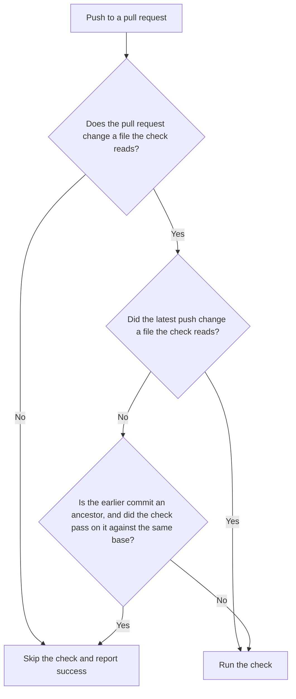

# Implementation Plan: CI Checks Scoped to Changed Files

**Branch**: `ci/workflows-scope-heavy-checks` | **Date**: 2026-11-24 | **Spec**: [spec.md](./spec.md)

**Input**: Feature specification from `.github/specs/026-ci-check-scope/spec.md`

## Summary

Add one script, `scripts/workflows/ci-scope.sh`, that decides whether a check has anything to do. Wire it into `lint.yml`, `workflow-lint.yml` and `tests.yml`. Each job keeps its name and gates its expensive steps on the decision.

## Technical Context

**Language/Version**: Bash, GitHub Actions workflow YAML

**Primary Dependencies**: `git`, and `gh` (preinstalled on GitHub-hosted runners)

**Testing**: Bats (`tests/bash/ci-scope.bats`), actionlint, Spectral, the existing Jest contract tests

**Constraints**: No constitution change, no locked file touched, required check names unchanged

**Scale/Scope**: One new script, one new test file, three workflows, this specification, the allocation ledger, the catalogue and the changelog

## Constitution Check

| Principle | Result | Note |
| --- | --- | --- |
| III. Asset boundaries | Pass | The script is repository-authored and lives in root `scripts/`. The rules exist in one place. |
| X. Automated validation | Pass | The checks still report on every pull request. Only work that cannot change the result is skipped. |

## Decisions

### Decision 1: gate steps, not jobs or workflows

- **Rationale**: A workflow-level path filter leaves a required check pending. A job-level `if:` relies on a skipped job counting as success. Gating steps inside the job means the job always completes normally and reports success itself.
- **Precedent**: `claude-guard-tests.yml` already gates its steps this way.

### Decision 2: use the earlier result for later pushes

- **Rationale**: Looking only at the whole pull request does not help the measured case. A pull request with code changes would still re-run everything for a later one-line Markdown push.
- **Rule**: Skip when the latest push changed no file the check reads and the same check concluded success on the commit before it, against the same base commit.
- **Safety**: The earlier commit must be an ancestor of the new head. Any other state runs the check.
- **Base**: A check runs on the merge of the head with the base, so a result is reused only for the same base. Each check records the base it tested as a notice annotation titled "CI scope base", and the next run reads it back. This came from review of the pull request.



### Decision 3: run only the prose-dependent tests for prose changes

- **Evidence**: The suite was run with a tracer that records every file read and every program started, per test file. It reads 11,495 of 11,745 tracked prose files. 47 test files read or check for those files, and 22 more start programs other than Node. An existence check counts, and a Node child's reads are attributed to the test that started it, which the first version of the tracer missed (found in review of the pull request).
- **Rule**: A change to prose alone runs those 69 test files. Anything else runs the whole suite. Jest is never skipped for a prose change.
- **Correction**: The earlier rule skipped Jest for plain `docs/` pages. All 141 of those pages are read by tests, so the rule could hide a failure. It is removed.
- **Measured**: The 69 files took 86 seconds locally against 100 seconds for the whole suite, a saving of about 14 percent. They include the tests that scan the whole repository, so Prose mode runs fewer tests, not much less time. On the pull request's own CI the head job took 130 seconds against 94 for the whole suite, which is within run-to-run variation.
- **Keeping the list true**: Every full run on a pull request head records a trace, and the job fails when a traced test file is missing from `tests/jest-prose-tests.json`.
- **Both targets**: The scope job passes the list to the head and base runs, so the comparison is like for like.

### Decision 4: every workflow change runs every scoped check

- **Rationale**: A mistake in a workflow or in the script should be caught by the checks it affects.

### Decision 5: add `checks: read`

- **Rationale**: The script reads the earlier check result through the GitHub API. The permission is read-only and scoped to the three workflows.

## Profiles

| Profile | Check | Files that run it |
| --- | --- | --- |
| `lint` | `Lint (JS/YAML/package.json)` | JavaScript and TypeScript files, YAML files, `package.json` and its lock file, root-level files other than prose |
| `typecheck` | `Typecheck` | JavaScript, TypeScript, Astro and JSON files, anything under `website/`, root-level files other than prose |
| `actionlint` | `actionlint` | `.github/actionlint.yaml`, `scripts/validation/run-actionlint.cjs`, root `package.json` and its lock file, and every `action.yml` or `action.yaml` (actionlint reads local action metadata to check the inputs a workflow passes, so a changed action can break a caller; found in review of the pull request) |
| `jest` | `No new test failures` | Everything except prose runs the whole suite. Prose alone runs the listed test files. |

All profiles also run for any file under `.github/workflows/`, for the script itself and for `.nvmrc`.

## Project Structure

```text
scripts/workflows/ci-scope.sh      # new: the rules
scripts/workflows/jest-read-tracer.cjs  # new: records what the suite reads
scripts/workflows/jest-prose-tests.cjs  # new: builds and checks the list
tests/jest.setup.read-trace.cjs    # new: names the running test file for the tracer
tests/jest-prose-tests.json        # new: the generated list
.jest.config.cjs                   # loads the setup file
tests/bash/ci-scope.bats           # new: 16 tests
.github/workflows/lint.yml         # gated: lint, typecheck
.github/workflows/workflow-lint.yml  # gated: actionlint
.github/workflows/tests.yml        # scope job calls the script
```

## Risks

| Risk | Mitigation |
| --- | --- |
| A profile misses a file the check reads | Lists err towards running. Workflow, script and root configuration changes always run. |
| The API call fails | The check runs. |
| A skipped result is trusted later | A skipped check reports success only when an earlier run on the same inputs passed, so the chain always ends at a real run. |
